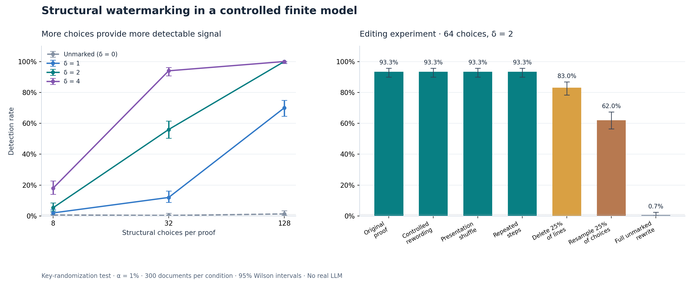

# Structural watermarking in a finite proof domain

A reproducible research prototype; no real LLM results.

The experiment evaluates an exact finite autoregressive reference distribution, not an LLM. There are 300 documents per condition, 199 independent surrogate keys per document, and a detection threshold α = 1%. The 5,700 document evaluations come from 1,200 independent task/key units: conditions are paired across strengths, and editing variants are paired within the attack cohort. They are not 5,700 independent trials.

## Findings

- At δ = 2, detection rises from 5.3% with 8 choices to 100.0% with 128 choices.
- In the 64-choice editing cohort, original, controlled-rewording, shuffled, and repeated-step versions each detect at 93.3%. This invariance is built into the declared parser and canonicalization.
- Deleting 25% of lines retains keyed evidence in 83.0% of documents, while 0.0% remain complete valid proofs. Evidence recovery is not proof validity.
- Resampling 25% of choices yields 62.0% detection; fully resampling from the unmarked model yields 0.7%. A resampled choice can equal its original value.

Across the unmarked length conditions, 7/900 documents detect (0.78%; 95% Wilson interval 0.38%–1.60%). By length: 8 choices: 2/300 (0.67%); 32 choices: 1/300 (0.33%); 128 choices: 4/300 (1.33%). The pooled interval is a descriptive summary across lengths, not a guarantee for each length or fixed key.

All full-proof conditions and all non-deletion editing variants have 100% valid proofs in this run. Deletion variants are incomplete and excluded from the likelihood-ratio analysis.

## Construction and detection

Each stage offers three sound two-step routes to the same next proposition: an intermediate modus-ponens route, conjunction introduction followed by modus ponens, or disjunction introduction followed by modus ponens. Only the first step is a choice; the forced completion adds no likelihood-ratio signal. Initial route probabilities are (0.55, 0.30, 0.15); later probabilities mix 75% of that baseline with 25% on the preceding route.

The numerical aggregation check recovers 3 canonical iToken masses from 9 terminated textual outcomes. Their token-product mass is 1; the maximum absolute discrepancy from the analytical route probabilities is 0. This verifies the finite construction, not probability recovery from an unrestricted language model.

The primary test scores distinct (semantic context, selected iToken) pairs and compares the real-key score with surrogate-key scores. The p-value is (1 + number of surrogate scores at least as large)/(R + 1); ties are conservative. Repeated steps do not add evidence. With 199 surrogates, p-values have a minimum of 0.005. Intervals are 95% Wilson intervals across independent task/key units within each row. Paired rows are correlated, and the intervals do not estimate paired differences.

The secondary likelihood-ratio detector uses the same preselected alternative δ = 2 for every condition. It is reported only for complete proofs and assumes the exact specified Markov baseline. Its guarantee does not extend to arbitrary unknown text distributions. The selectively rerouted rows show descriptive likelihood-ratio scores: resampling some choices can change the null path distribution, so proof completeness alone does not preserve the original false-positive guarantee.

## Length and strength results

| Choices | δ | Detected / n | Primary rate [95% CI] | Secondary LLR [95% CI] | Valid proof |
| --- | --- | --- | --- | --- | --- |
| 8 | 0 | 2/300 | 0.7% [0.2%, 2.4%] | 0.0% [0.0%, 1.3%] | 100.0% |
| 8 | 1 | 6/300 | 2.0% [0.9%, 4.3%] | 0.7% [0.2%, 2.4%] | 100.0% |
| 8 | 2 | 16/300 | 5.3% [3.3%, 8.5%] | 3.3% [1.8%, 6.0%] | 100.0% |
| 8 | 4 | 54/300 | 18.0% [14.1%, 22.7%] | 17.7% [13.8%, 22.4%] | 100.0% |
| 32 | 0 | 1/300 | 0.3% [0.1%, 1.9%] | 0.3% [0.1%, 1.9%] | 100.0% |
| 32 | 1 | 36/300 | 12.0% [8.8%, 16.2%] | 10.0% [7.1%, 13.9%] | 100.0% |
| 32 | 2 | 168/300 | 56.0% [50.3%, 61.5%] | 76.0% [70.9%, 80.5%] | 100.0% |
| 32 | 4 | 282/300 | 94.0% [90.7%, 96.2%] | 100.0% [98.7%, 100.0%] | 100.0% |
| 128 | 0 | 4/300 | 1.3% [0.5%, 3.4%] | 0.0% [0.0%, 1.3%] | 100.0% |
| 128 | 1 | 210/300 | 70.0% [64.6%, 74.9%] | 31.7% [26.7%, 37.1%] | 100.0% |
| 128 | 2 | 300/300 | 100.0% [98.7%, 100.0%] | 100.0% [98.7%, 100.0%] | 100.0% |
| 128 | 4 | 300/300 | 100.0% [98.7%, 100.0%] | 100.0% [98.7%, 100.0%] | 100.0% |

## Editing results

| Variant | Detected / n | Primary rate [95% CI] | Mean choices | Valid proof | Secondary LLR [95% CI] |
| --- | --- | --- | --- | --- | --- |
| Original proof | 280/300 | 93.3% [89.9%, 95.6%] | 64.00 | 100.0% | 96.3% [93.6%, 97.9%] |
| Controlled rewording | 280/300 | 93.3% [89.9%, 95.6%] | 64.00 | 100.0% | 96.3% [93.6%, 97.9%] |
| Presentation shuffle | 280/300 | 93.3% [89.9%, 95.6%] | 64.00 | 100.0% | 96.3% [93.6%, 97.9%] |
| Repeated steps | 280/300 | 93.3% [89.9%, 95.6%] | 64.00 | 100.0% | 96.3% [93.6%, 97.9%] |
| Delete 25% of lines | 249/300 | 83.0% [78.3%, 86.8%] | 47.76 | 0.0% | Not eligible |
| Resample 25% of choices | 186/300 | 62.0% [56.4%, 67.3%] | 64.00 | 100.0% | 67.0% [61.5%, 72.1%] |
| Full unmarked rewrite | 2/300 | 0.7% [0.2%, 2.4%] | 64.00 | 100.0% | 0.0% [0.0%, 1.3%] |

## Example browser

Open [the standalone HTML report](report.html) to select an editing variant and inspect its proof text and precomputed detection result. The selector does not run a detector.

## Limits

- No real LLM was used. The scorer bridge accepts externally supplied token log probabilities but has only synthetic analytic tests; its output is conditional on the listed candidates.
- Only three controlled rendering grammars are recognized. Arbitrary paraphrases, general semantic equivalence, creative ideas, and natural-language extraction are not tested.
- Detection requires the original public problem and its stable identifier. Unsupported text, ambiguous routes, and text outside the admitted domain trigger abstention.
- The randomization guarantee assumes the document is independent of the randomly selected secret key under the null. It averages over keys and gives no universal fixed-key or adaptive adversarial guarantee.
- Strong bias and longer proofs can increase detectability, but idea quality, novelty, and realistic generation costs have not been measured. Independent structural rewriting can erase the signal.
- The example key and reproducible simulation seeds are public. This package demonstrates a protocol; its examples cannot provide private provenance or ownership evidence.

## Reproduce and inspect

- [README and commands](../README.md)
- [Formal framework](../THEORY.md)
- [Related work](../RELATED_WORK.md)
- [Summary data](../results/summary.json)
- [Trial data](../results/trials.csv)
- [Example variants](../results/example_variants.json)
- [External-score bridge](../scored_candidates.py)
- [Validation log](../validation.txt)
- [PNG figure](results.png)
- [SVG figure](results.svg)
